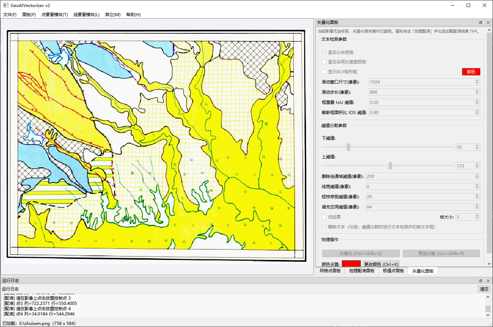
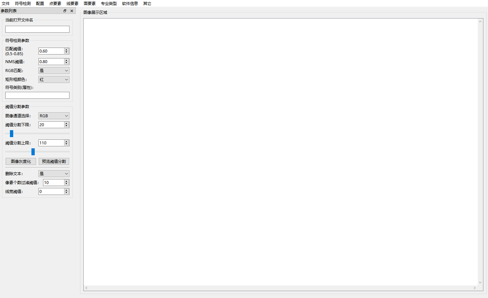

# GeoAIVectorizer
### GeoAIVectorizer, Intelligent vectorization of geological grid maps

    <a href="./README.md">English</a> |
    <a href="./README_zh.md">简体中文</a>

## 1. Introduction to GeoAIVectorizer (Intelligent Vectorization Software for Geological Maps)
* Intelligent (automatic) vectorization of geological maps: developed with interdisciplinary technologies including deep learning, GIS, image processing, software engineering, and geology.
* 2026.11.01: Official release of v2.0. New features: geographic registration & projection, more powerful OCR capabilities (tiled prediction, grayscale image prediction, ROI region filtering), better line vectorization, inversion of geochemical results back to the original map (more complex functions), line simplification, grid line filtering...
* 
  

* 2024.12.10: Official release of v1.0. Features: detection, recognition and vectorization of point symbols in geological maps, text point vectorization, line vectorization (AI-OCR-assisted interference removal), polygon vectorization, geological-domain OCR datasets + models, line simplification.
* 
  

## 2. Applications
* v1.0
* Certain units of the China Geological Survey (CGS)
* Geological units of various provinces in China
* Currently deployed in 10+ geological units across 5 provinces in China
* v2.0
* In progress

## GeoAIVectorizer v1.0 vs v2.0 Comparison
| Item | v1.0 | v2.0 |
| --- | --- | --- |
| Online or Offline | Offline | Offline |
| Development approach | Manually designed and written code | Code restructured + generated with cursor + trae; AI took over 99% of the code, datasets + models remain independent |
| Python | 3.9 | 3.12 |
| PaddleOCR | 2.6 (ppocrv4) | 3.7 (ppocrv6) |
| GDAL | 3.4 | 3.12 |
| GeoPandas | 0.14 | 1.2 |
| GUI framework | QT for Python (PySide6) | QT for Python (PySide6) |
| OpenCV | opencv-python 4.5 | opencv-python 5 |
| Point symbol detection | Self-developed CV algorithm | N/A |
| CUDA | 11.2 | 12.9 |
| Geographic registration & projection | Not supported | Supported |
| OCR capability | Professional model, full-image prediction | Professional model, tiled prediction, grayscale image prediction, ROI filtering |
| Line vectorization | AI-OCR-assisted interference removal | More powerful line vectorization |
| Grid line filtering, line simplification & other features | Partially supported | Supported |
| Inversion of geochemical results | Not supported | Supported (more complex functions...) |

### v3.0 (TODO 2027)
* Planned (more complex features)
* qwen3-vl or not
* mcp or not
* agent or not
* Qgis or rustGIS
* ollama or xinference
* fastapi or not
* docker or not
